# Palette Picker: A very useful color palette program from 1994

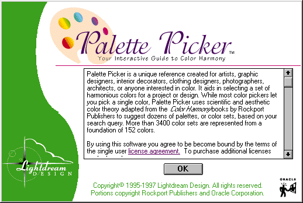

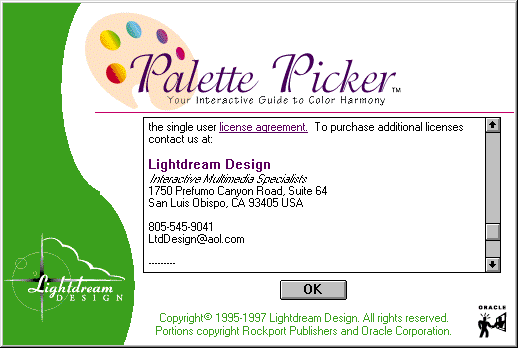

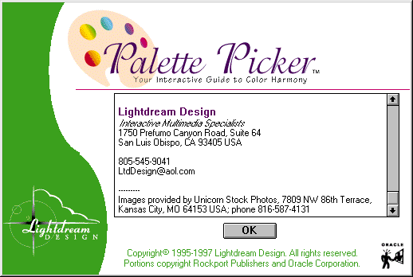

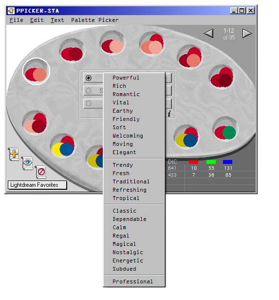

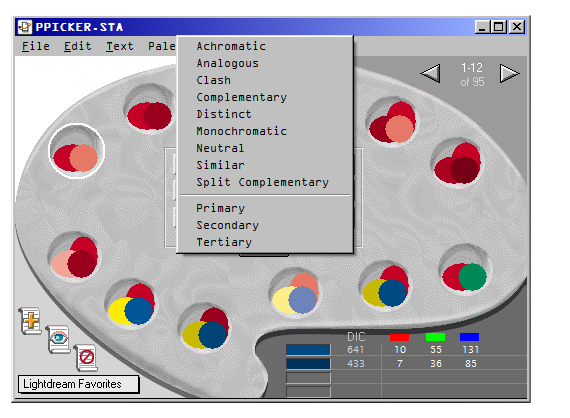

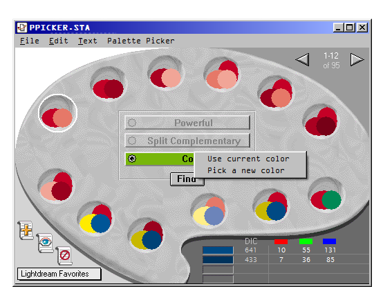

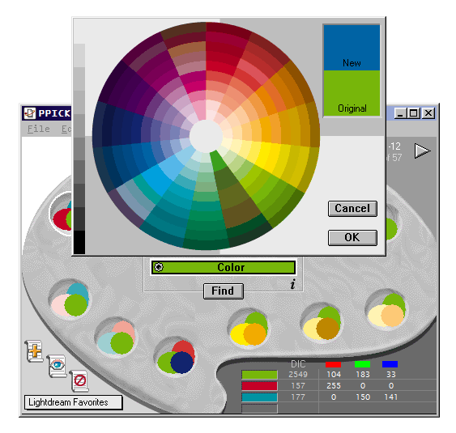

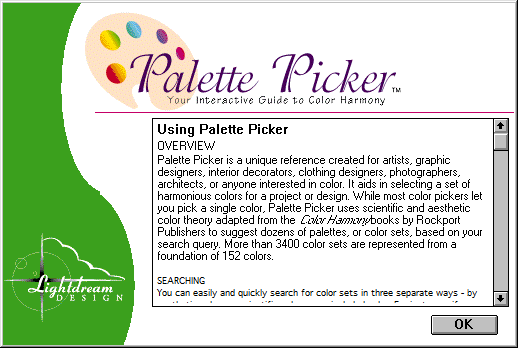

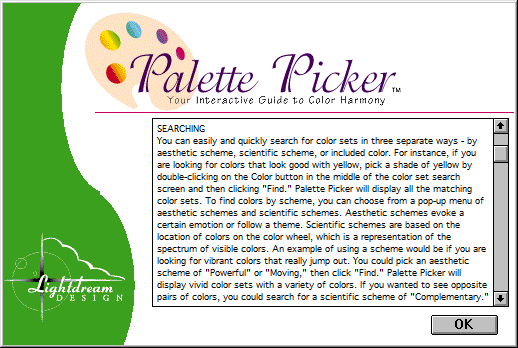

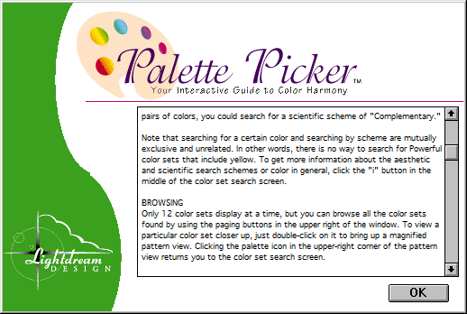

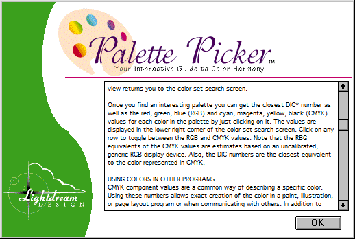

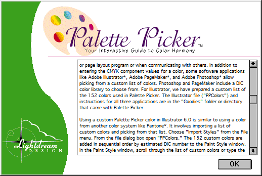

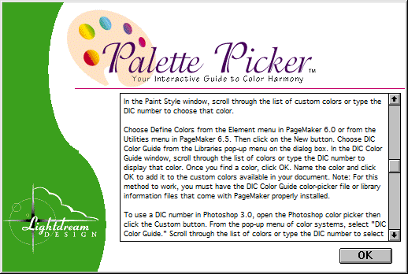

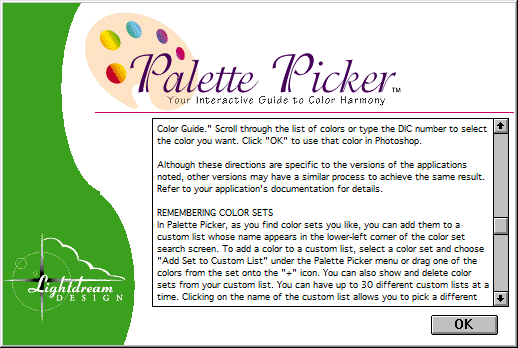

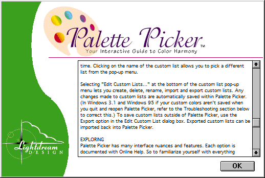

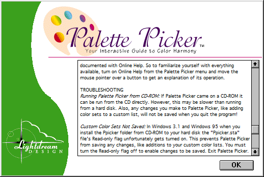

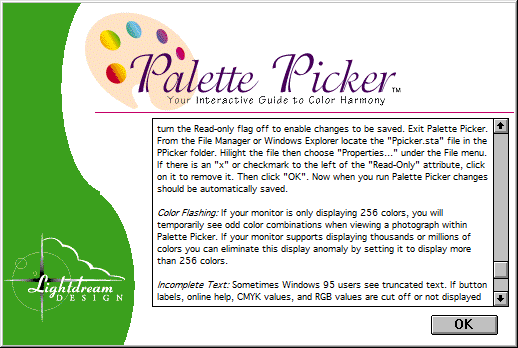

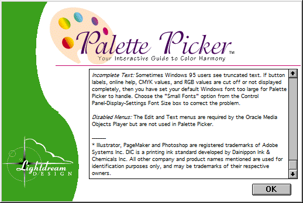

**Palette Picker appears to qualify as abandonware in the practical sense: it is long-unmaintained software for which there is no current official sales channel.** Its last purchase date cannot be established. However, there is a fairly substantial historical trail - and **Lightdream Design continued long after the program's apparent disappearance**, eventually focusing on educational media, digital art, and books. Its original domain still [serves a website](https://lightdream.com).

Lightdream's own [archived troubleshooting page, captured January 21, 2001](https://web.archive.org/web/20010121194800/http://lightdream.com:80/troubleshooting.htm), explicitly identifies:

- **`Ppicker.sta`** as the Windows document.
- **`OMOPlay.exe`** as the executable that opens it.
- **Oracle Media Objects Player** as the required runtime.

It even describes the problem of Windows 95 assigning `.sta` files to another application, and instructs users to drag `Ppicker.sta` onto `OMOPlay.exe` or repair the file association. The same page documents a Macintosh version using Oracle Media Objects Player.

There is also a [screenshot](https://graphics.stanford.edu/courses/cs448b-02-spring/04cdrom.pdf#page=47) in Maureen Stone's **SIGGRAPH 2001** course notes showing the window title **`PPICKER.STA`**, alongside the Palette Picker name and `www.lightdream.com`. That independently confirms that the surviving references concern the program.

## When was it last available for purchase?

**Its commercial distribution and later availability references can be established, but a definitive end-of-sales date cannot.** Here is the chronology supported by the sources:

| Date | Evidence | What it establishes |
|---|---|---|
| **1994** | Maureen Stone's subsequent book identifies this as the software's release year. | A reported original release date; it should not be treated as its discontinuation date. |
| **1997** | A Rockport Publishers edition of Bride M. Whelan's *Color Harmony 2* included Palette Picker. | A documented commercial book/software package. |
| **1999** | Stone's Stanford course bibliography identifies the Windows application bundled with the book and also available from Lightdream's website. | A contemporary distribution reference. |
| **February 5, 2001** | The latest original Lightdream product-page capture that was recovered that still advertises Palette Picker and offers Macintosh and Windows demos. | The program was still being promoted on the original website at that capture date. |
| **August 12, 2001** | Stone's SIGGRAPH course notes again describe the program as available from `www.lightdream.com`. | The latest contemporary availability statement which was located. |
| **2003** | Stone describes the download in the past tense and reports that the program had not been maintained or upgraded since release. | Strong evidence of an already neglected product by 2003, but no precise final sales date. |

Sources: [Lightdream's February 2001 product page](https://web.archive.org/web/20010205062600/http://lightdream.com:80/products.htm), the 1997 bibliographic record, Stanford's 1999 bibliography, the 2001 course notes, and [Stone's 2003 book](https://books.google.com/books?id=m4OXQQAACAAJ).

### The strongest evidence about its abandonment

In [*A Field Guide to Digital Color*, **page 309**](https://www.scribd.com/document/847209718/A-Field-Guide-to-Digital-Color#page=309), Maureen C. Stone discusses the Palette Picker CD-ROM included with *Color Harmony 2*. She says the tool had previously been available as a download and:

> "hasn't been maintained or upgraded since its release in 1994."

The book's publication is documented as [**July 2003**](https://www.scribd.com/document/847209718/A-Field-Guide-to-Digital-Color#page=5) by the author's institutional publication record. This is useful contemporary testimony about the program's condition, rather than a much later abandonware-site classification.

### Why "2001" is not a definite last-sale year

The [original product page](https://web.archive.org/web/20010205062600/http://lightdream.com:80/products.htm) offers a fully functional demonstration, listed as **1 MB for Windows** and **1.7 MB for Mac OS**. There is no price, order form, purchase button, or registration instructions on that page.

Also, Lightdream subsequently used a Flash-based website. Some of the material needed to reconstruct its later navigation was not preserved in the archive. Consequently, the end of the recoverable HTML product pages cannot establish when the business stopped accepting orders.

**The defensible answer is therefore: the program was commercially distributed with a 1997 book/CD package, remained advertised or referenced as available in 2001, and was described as unmaintained with a former download offering by 2003. The final date of an actual purchase remains unverified.**

For identifying the commercial package, the useful ISBNs are:

- **ISBN-10:** `1564964019`
- **ISBN-13:** `9781564964014`

The catalog records distinguish that edition from the book-only edition, ISBN `1564960668`. This matters because an [ordinary copy of *Color Harmony 2*](https://books.google.com/books?id=m4OXQQAACAAJ) is not necessarily the software-bearing package.

## What happened to Lightdream Design?

This part turned out to be more traceable than the final sale date.

### It was a multimedia business associated with Mark and Rhonda Greenelsh

The company's [February 1998 About page](https://web.archive.org/web/19980210131411/http://www.lightdream.com:80/about.html) places it in **Grover Beach, California**, and names **Mark Greenelsh and Rhonda Greenelsh**.

It describes a business handling interactive multimedia design, production, and training, including print, video, touchscreen kiosks, and CD-ROMs. Mark's background was multimedia and technology; Rhonda was described as a photographer and writer.

That broader business is relevant: **Palette Picker was one product within a multimedia/design practice**, so the program's decline does not imply the whole business immediately closed.

### The company continued into custom software and educational media

A [July 2002 capture of the later website](https://web.archive.org/web/20020725140054/http://www.lightdream.com:80/splash.html) describes Lightdream as a contract software-development and design firm producing custom applications and multimedia for business, education, healthcare, government, and nonprofit clients.

A [company page preserved in December 2012](https://web.archive.org/web/20121202032409/http://www.lightdream.com:80/blog/) is more specific:

- It describes interactive media work for **education and training**.
- It explicitly identifies **Mark Greenelsh as Lightdream's principal**.
- It says he also taught high-school media literacy and produced media projects for ministry.

An independent school biography corroborates that career path. Lopez High School [identifies Greenelsh](https://lopezhighschool.weebly.com/mark-greenelsh.html) as a **Digital Media Arts and Yearbook teacher**, describes his earlier interactive-multimedia work, and credits him with several commercial software titles and seven books. The page is undated, so its reference to eleven years of teaching cannot safely be converted into an exact career timeline.

### By 2015, the website had become an art gallery

The [May 2015 archived contact/about page](https://web.archive.org/web/20150531052837/http://www.lightdream.com:80/contact/) explicitly identifies the gallery's artist as **Mark Greenelsh**. It offers digital artwork and discusses licensing and printing it.

That gives a direct link between the old multimedia company and the later art website. The domain's later content is connected to the same person.

### The original domain still has a Lightdream Design site

The accessible address is now:

**[Lightdream Design - Art and books](https://lightdream.com/wp/)**

The site features the *Wonder* coloring/puzzle book, an About section describing teaching, ministry media, and digital art, and a contact form. Its footer reads **© 2014–2019 Lightdream Design**. Thus, the website remains accessible, although that alone does not establish how actively the business currently operates or whether the biographical text is up to date.

### There is a business-license lapse in the public record

A **[December 9, 2020 San Luis Obispo Tribune report](https://www.sanluisobispo.com/news/business/article247671470.html)** listing **Lightdream Design** was found among businesses that did not renew their **2019–2020 San Luis Obispo business licenses**. The name and region make this a relevant lead.

That is narrower evidence than a formal dissolution notice. The article itself explains that some listed businesses continued elsewhere or changed their operations. It therefore does **not** establish that Lightdream was legally dissolved, that the pandemic caused its closure, or that Palette Picker remained on sale until 2020.

**The interpretation of the combined evidence is that Lightdream's work evolved away from the old packaged software into custom/educational media and then art and books.** No documented acquisition, transfer of Palette Picker to another software publisher, or announcement explaining its discontinuation was found.

## Its abandonware status described

The following distinctions are assumed:

| Question | Assessment |
|---|---|
| **Is it long-unmaintained legacy software?** | **Strongly supported.** A contemporary 2003 reference already described it that way. |
| **Is it currently offered for sale by the original developer?** | **There are no current official offers.** The surviving site focuses on art and books. |
| **Is there a verified final sale/discontinuation date?** | **No.** The dated evidence supports availability references through 2001 and a past-tense download reference in 2003. |
| **Did the developer disappear immediately afterward?** | **No.** The company and its principal are documented in later educational-media and art activities. |
| **Was it formally released as freeware or public domain?** | **No such declaration was found.** |

"Abandonware" is useful here as a description of the program's commercial and maintenance history. It does not itself establish permission to redistribute the software; copyright status depends on separate facts, and ordinary copyright terms [extend well beyond the age of this program](https://www.copyright.gov/history/copyright-exhibit/lifecycle).

One useful remaining lead is that **the original principal is identifiable and the [Lightdream contact form](https://lightdream.com/wp/contact/) is still present**. Mark Greenelsh would be the strongest potential source for the two facts the surviving public record does not settle: **when Palette Picker sales actually stopped, and whether he would authorize preservation or redistribution of it.** The form's presence is verifiable; whether it is still monitored is unknown.

# "Dirty-room" findings: functional description of the original color-set reference program

Audience: the CLEAN agent. This document describes **what** the original program does and the **factual data** it contains. It deliberately omits source code, implementation technique, layout/artwork, logos and prose. Where original explanatory text existed it has been paraphrased in my own words.

Verdict on usability: the archive was examined without problems. All numeric data (152-color palette, 3,400 color sets, scheme membership) was recovered and cross-checked for internal consistency. Nothing here blocks a clean rebuild.

Companion data files (plain facts, no code) are in `/home/ubuntu/pp_clean_room/data/`:

| File | Contents |
|---|---|
| `palette_152.csv` | The 152 base colors: internal color ID, estimated DIC ink number, label, RGB, hex, CMYK, value-row / hue-column position |
| `color_sets_3400.csv` | The 3,400 color sets: set ID, size (2–4), and the color IDs in each set |
| `scheme_membership.json` | Which set IDs belong to each mood scheme, each color-theory scheme, and each base color (keys `mood`, `scientific`, `by_color`) |

---

## 1. Archive contents

| Path | What it is (functionally) |
|---|---|
| `PPICKER.STA` (2.1 MB) | The program itself: a multimedia "stack" containing the UI, the data tables below, and the reference text |
| `PPICKER.STA.lnk` | Windows shortcut |
| `README.WRI` | Windows Write document: overview, system requirements (Windows 3.1/95, 256-color display), install steps, troubleshooting (read-only flag, 256-color flashing, large-font truncation), copyright/contact |
| `PLAYER/OMOPLAY.EXE` + `PLAYER/OBJECTS/*.MOX` + `PLAYER/LIBRARY/SYSTEM` | The third-party runtime player and its plug-in object modules (buttons, fields, lists, bitmaps, palettes, datasheets, sounds, timers, etc.). No application data. |
| `GOODIES/PPCOLORS.EPS` | An Illustrator 3.2 EPS whose only payload is a list of 152 named custom CMYK colors ("Est. DIC nnn"), so the palette can be imported into Illustrator. It also contains the three-line note that the file holds the 152 colors labeled by closest DIC number. |
| `GOODIES/README.WRI` | How to use the 152 colors in Illustrator (import the EPS as styles), PageMaker (DIC library) and Photoshop (DIC Color Guide custom picker). |

Photo examples referenced by the help/info pages were on the CD-ROM (`PPPhotos` folder) and are **not** in the archive.

---

## 2. Scheme categories (confirmed from the file)

### 2.1 Aesthetic / mood schemes — 24 total (not 25)

The menu is split by separators into four groups:

- Warm group (10): **Powerful, Rich, Romantic, Vital, Earthy, Friendly, Soft, Welcoming, Moving, Elegant**
- Medium group (5): **Trendy, Fresh, Traditional, Refreshing, Tropical**
- Cool group (8): **Classic, Dependable, Calm, Regal, Magical, Nostalgic, Energetic, Subdued**
- Gray group (1): **Professional**

(The screenshots agree. Internally one record is misspelled "Powerfull"; treat it as Powerful.)

### 2.2 Scientific / color-theory schemes — 12 total

Menu order: **Achromatic, Analogous, Clash, Complementary, Distinct, Monochromatic, Neutral, Similar, Split Complementary**, separator, **Primary, Secondary, Tertiary**. The list given in the task is correct.

### 2.3 Third search mode — a specific color

The user can search by one of the 152 base colors (picked from a color-wheel dialog, re-used from the previous search, or dragged from a displayed set onto the color well). This is a **precomputed exact-match lookup**: the result is every set that contains that exact base color. There is no "nearest color" matching. The three search modes are mutually exclusive — there is no combined "Powerful sets containing yellow" query.

---

## 3. Meaning of each scheme (paraphrased)

### Scientific schemes (short definitions in the program)

| Scheme | Meaning, in my words |
|---|---|
| Achromatic | Built from neutrals only: black, white and grays (the data also pairs one hue with black). |
| Analogous | Neighboring hues on the wheel, in any of their tints or shades. |
| Clash | A hue combined with the hue just to one side of its complement. |
| Complementary | Hues directly opposite each other on the wheel. |
| Distinct | Three contrasting hues plus one more color that clearly stands apart (always 4 colors). |
| Monochromatic | One hue together with its own tints and/or shades. |
| Neutral | A hue dulled by mixing in its complement or black. |
| Similar | Like analogous (adjacent hues), but specifically balanced by mixing pale and bright members. |
| Split Complementary | A hue plus the two hues flanking its complement (always 3 colors). |
| Primary | Red, yellow and blue together. |
| Secondary | Orange, green and violet together. |
| Tertiary | One of the two equidistant triads of tertiary hues: red-orange / yellow-green / blue-violet, or blue-green / yellow-orange / red-violet. |

### Mood schemes (each is anchored on a "central hue"; longer essay text in the program, paraphrased)

| Mood | Central hue / idea |
|---|---|
| Powerful | Saturated red; bold, attention-grabbing, strong emotion |
| Rich | A strong hue plus its darkened complement — burgundy, forest green, gold; wealth and drama |
| Romantic | Pink (lightened red) with other pastels such as lavender and peach; gentle, tender |
| Vital | Vermilion / red-orange, often with its complement turquoise; energetic, youthful |
| Earthy | Terra-cotta (dark vivid red-orange), warm analogous tones; natural, Southwestern |
| Friendly | Orange and its neighbors; open, inviting, informal |
| Soft | Low-contrast light tints, peach-centered, sometimes with violet and green tints; relaxing |
| Welcoming | Yellow-orange / amber / saffron, creamy tints; cordial, festive |
| Moving | Primary yellow, high contrast e.g. with violet; brightness and motion |
| Elegant | Only the palest tints — cream, eggshell, linen; understated |
| Trendy | Chartreuse / yellow-green as accent, e.g. against magenta; offbeat |
| Fresh | Green with small red accents or with sky blue; outdoor, healthy |
| Traditional | Grayed/deepened blue, burgundy, tan, hunter green, gold, black; conservative, stable |
| Refreshing | Teal / blue-green with red-orange; crisp and calm |
| Tropical | Turquoise and the lightest blue-green tints, with red-orange; serene |
| Classic | Intense royal blue, often with its split complements red-orange and yellow-orange; authority, trust |
| Dependable | Navy blue, optionally accented with red and gold; reliable, authoritative |
| Calm | Grayed or lightened blues with similar-value accents; restful |
| Regal | Blue-violet (darkest hue) with yellow-orange; royal, imposing |
| Magical | Violet with orange and green, or with chartreuse / yellow-orange; whimsical, surprising |
| Nostalgic | Lavender with other pastels; Victorian, dreamy |
| Energetic | Red-violet / fuchsia / magenta, often with chartreuse; exuberant |
| Subdued | Mauve and other grayed tints and shades; low contrast, needs a spark of complement |
| Professional | Grays and tonal blacks, optionally with one vivid accent (accented neutral); sober, practical |

### Other reference topics in the program (paraphrased, for optional help pages)

- **The color wheel**: 12 hues — 3 primaries (red at the top), 3 secondaries, 6 tertiaries; tints = hue + white, shades = hue + black/gray; the twelve pure hues are fully saturated.
- **Picking colors** — four steps: define the result you want; choose a main color; choose a scheme around that hue; refine for the project or personal taste.
- **Aspects of color**: hot (saturated red), cold (saturated blue), warm (reds containing yellow), cool (blues containing yellow), light (palest pastels), dark (hues containing black), pale (≥ ~65 % white), bright (no gray/black).

---

## 4. Color sets: structure and counts

- A set has **2, 3 or 4 colors**. Counts: 1,340 two-color sets, 1,719 three-color sets, 342 four-color sets, **3,400 sets in total** (the program's marketing figure is "more than 3,400"; internally there is one extra all-blank padding row, which is not a real set).
- Each set is identified by an integer **set ID 1–3400**. Set IDs are the display order; results are always shown in ascending set-ID order.
- 2,885 of the 3,400 sets are distinct color combinations; some combinations recur under different set IDs (they appear in different schemes). Duplicates were kept to match the original counts.
- A set is listed in **at most one mood** and **at most one scientific scheme**. 2,134 sets have a mood, 2,680 have a scientific scheme, 1,414 have both, and every real set has at least one.
- Sets per scheme (verified counts):

| Mood | Sets | Sizes | | Mood | Sets | Sizes |
|---|---|---|---|---|---|---|
| Powerful | 95 | 2–3 | | Tropical | 203 | 2–3 |
| Rich | 113 | 2–4 | | Classic | 59 | 2–3 |
| Romantic | 59 | 2–3 | | Dependable | 59 | 2–3 |
| Vital | 95 | 2–3 | | Calm | 95 | 2–3 |
| Earthy | 149 | 2–4 | | Regal | 59 | 2–3 |
| Friendly | 95 | 2–3 | | Magical | 59 | 2–3 |
| Soft | 59 | 2–3 | | Nostalgic | 95 | 2–3 |
| Welcoming | 59 | 2–3 | | Energetic | 95 | 2–3 |
| Moving | 131 | 2–4 | | Subdued | 59 | 2–3 |
| Elegant | 59 | 2–3 | | Professional | 57 | 3 |
| Trendy | 95 | 2–3 | | | | |
| Fresh | 59 | 2–3 | | | | |
| Traditional | 131 | 2–4 | | | | |
| Refreshing | 95 | 2–3 | | | | |

| Scientific | Sets | Sizes |
|---|---|---|
| Achromatic | 225 | 2–3 |
| Analogous | 330 | 3–4 |
| Clash | 544 | 2–3 |
| Complementary | 424 | 2–3 |
| Distinct | 36 | 4 |
| Monochromatic | 281 | 2–3 |
| Neutral | 184 | 2–3 |
| Similar | 288 | 2–3 |
| Split Complementary | 276 | 3 |
| Primary | 32 | 3 |
| Secondary | 24 | 3 |
| Tertiary | 36 | 3 |

- Sets per base color (the by-color search): minimum 6, maximum 245 (pure red). Every one of the 152 colors is used in at least one set.
- The full membership lists are in `scheme_membership.json`; the by-color lists there are identical to simply indexing `color_sets_3400.csv` by color (verified), so the clean build can compute them instead of storing them.

---

## 5. The 152-color base palette — recovered

Each color has: an internal **color ID** (16–175 plus 255 for black), an **estimated DIC ink number** (several colors share a DIC number; e.g. 643 appears four times, 222 four times — they are different tints, so DIC is a label, not a key), a short **label**, **RGB** (0–255, uncalibrated generic display estimate), and **CMYK** (0–100 %).

Useful structural fact: the color IDs form a 10 × 16 grid. `value_row = ID div 16` runs 1 (darkest) to 10 (lightest); `hue_col = ID mod 16` is the hue family: 0 red, 1 red-orange, 2 orange, 3 orange-yellow, 4 yellow, 5 yellow-green, 7 green, 8 green-blue, 10 blue, 11 blue-violet, 12 violet, 13 red-violet, 15 gray; columns 6, 9 and 14 hold assorted named colors (browns, teals, pinks, etc.). Nine grid slots are empty (IDs 31, 70, 102, 105, 134, 137, 166, 169, 174), and black is a separate ID 255. The original color-wheel picker shows the 12 hue columns as wedges, the value rows as rings (dark outside, light inside), the gray column as a separate strip, and black at the end of that strip.

Labels of the form "Red 1 … Red 8" etc. are generic; the other labels are the ink standard's conventional color names. The clean build may rename freely.

| ID | Est. DIC | Label | R | G | B | Hex | C | M | Y | K | value row | hue col |
|---|---|---|---|---|---|---|---|---|---|---|---|---|
| 16 | 2488 | Red 1 | 140 | 0 | 0 | #8c0000 | 0 | 100 | 100 | 45 | 1 | 0 |
| 17 | 2486 | Red-orange 1 | 140 | 13 | 16 | #8c0d10 | 0 | 90 | 80 | 45 | 1 | 1 |
| 18 | 338 | Orange 1 | 141 | 56 | 0 | #8d3800 | 0 | 60 | 100 | 45 | 1 | 2 |
| 19 | 338 | Orange-yellow 1 | 141 | 84 | 0 | #8d5400 | 0 | 40 | 100 | 45 | 1 | 3 |
| 20 | 244 | Yellow 1 | 142 | 140 | 0 | #8e8c00 | 0 | 0 | 100 | 45 | 1 | 4 |
| 21 | 2482 | Yellow-green 1 | 57 | 101 | 18 | #396512 | 60 | 0 | 100 | 45 | 1 | 5 |
| 22 | 379 | Peacock green | 0 | 27 | 11 | #001b0b | 100 | 80 | 100 | 0 | 1 | 6 |
| 23 | 643 | Green 1 | 0 | 76 | 38 | #004c26 | 100 | 0 | 90 | 45 | 1 | 7 |
| 24 | 406 | Green-blue 1 | 0 | 83 | 77 | #00534d | 100 | 0 | 40 | 45 | 1 | 8 |
| 25 | 2403 | Violet | 57 | 34 | 82 | #392252 | 80 | 80 | 45 | 0 | 1 | 9 |
| 26 | 2393 | Indigo | 6 | 30 | 62 | #061e3e | 100 | 80 | 60 | 0 | 1 | 10 |
| 27 | 449 | Aubergine purple | 9 | 15 | 69 | #090f45 | 100 | 90 | 50 | 0 | 1 | 11 |
| 28 | 257 | Violet 1 | 36 | 0 | 69 | #240045 | 80 | 100 | 0 | 45 | 1 | 12 |
| 29 | 2298 | Red-violet 1 | 86 | 0 | 70 | #560046 | 40 | 100 | 0 | 45 | 1 | 13 |
| 30 | 2271 | Chestnut | 64 | 17 | 4 | #401104 | 75 | 90 | 100 | 0 | 1 | 14 |
| 32 | 196 | Crimson | 179 | 0 | 25 | #b30019 | 30 | 100 | 80 | 0 | 2 | 0 |
| 33 | 2483 | Red-orange 2 | 190 | 18 | 21 | #be1215 | 0 | 90 | 80 | 25 | 2 | 1 |
| 34 | 202 | Orange 2 | 192 | 76 | 0 | #c04c00 | 0 | 60 | 100 | 25 | 2 | 2 |
| 35 | 241 | Orange-yellow 2 | 193 | 114 | 0 | #c17200 | 0 | 40 | 100 | 25 | 2 | 3 |
| 36 | 2079 | Mustard | 206 | 184 | 9 | #ceb809 | 20 | 20 | 100 | 0 | 2 | 4 |
| 37 | 2552 | Yellow-green 2 | 78 | 137 | 25 | #4e8919 | 60 | 0 | 100 | 25 | 2 | 5 |
| 38 | 378 | Pine green | 0 | 54 | 22 | #003616 | 100 | 60 | 100 | 0 | 2 | 6 |
| 39 | 643 | Green 2 | 0 | 103 | 52 | #006734 | 100 | 0 | 90 | 25 | 2 | 7 |
| 40 | 2579 | Peacock blue | 3 | 111 | 110 | #036f6e | 100 | 25 | 50 | 0 | 2 | 8 |
| 41 | 2380 | Tarnished pale blue | 105 | 136 | 158 | #69889e | 60 | 30 | 20 | 0 | 2 | 9 |
| 42 | 433 | Blue 1 | 7 | 36 | 85 | #072455 | 100 | 60 | 0 | 45 | 2 | 10 |
| 43 | 222 | Blue-violet 1 | 10 | 10 | 73 | #0a0a49 | 100 | 90 | 0 | 45 | 2 | 11 |
| 44 | 580 | Violet 2 | 49 | 0 | 94 | #31005e | 80 | 100 | 0 | 25 | 2 | 12 |
| 45 | 497 | Plum | 94 | 18 | 69 | #5e1245 | 65 | 90 | 50 | 0 | 2 | 13 |
| 46 | 2243 | Reddish-brown | 103 | 0 | 13 | #67000d | 60 | 100 | 90 | 0 | 2 | 14 |
| 47 | 525 | Gray 9 | 38 | 38 | 38 | #262626 | 0 | 0 | 0 | 85 | 2 | 15 |
| 48 | 2490 | Red 2 | 191 | 0 | 0 | #bf0000 | 0 | 100 | 100 | 25 | 3 | 0 |
| 49 | 2495 | Red-orange 3 | 216 | 20 | 40 | #d81428 | 0 | 90 | 80 | 15 | 3 | 1 |
| 50 | 202 | Orange 3 | 218 | 86 | 0 | #da5600 | 0 | 60 | 100 | 15 | 3 | 2 |
| 51 | 207 | Ocher | 206 | 138 | 7 | #ce8a07 | 20 | 40 | 100 | 0 | 3 | 3 |
| 52 | 209 | Yellow 2 | 194 | 190 | 0 | #c2be00 | 0 | 0 | 100 | 25 | 3 | 4 |
| 53 | 2552 | Yellow-green 3 | 88 | 155 | 28 | #589b1c | 60 | 0 | 100 | 15 | 3 | 5 |
| 54 | 346 | Brownish-green | 77 | 51 | 12 | #4d330c | 70 | 70 | 100 | 0 | 3 | 6 |
| 55 | 643 | Green 3 | 0 | 117 | 59 | #00753b | 100 | 0 | 90 | 15 | 3 | 7 |
| 56 | 217 | Green-blue 2 | 0 | 113 | 106 | #00716a | 100 | 0 | 40 | 25 | 3 | 8 |
| 57 | 414 | Young bamboo | 79 | 137 | 144 | #4f8990 | 70 | 25 | 30 | 0 | 3 | 9 |
| 58 | 641 | Blue 2 | 9 | 49 | 115 | #093173 | 100 | 60 | 0 | 25 | 3 | 10 |
| 59 | 222 | Blue-violet 2 | 13 | 13 | 99 | #0d0d63 | 100 | 90 | 0 | 25 | 3 | 11 |
| 60 | 580 | Violet 3 | 55 | 0 | 106 | #37006a | 80 | 100 | 0 | 15 | 3 | 12 |
| 61 | 2618 | Red-violet 2 | 117 | 0 | 95 | #75005f | 40 | 100 | 0 | 25 | 3 | 13 |
| 62 | 2269 | Amber | 154 | 62 | 37 | #9a3e25 | 40 | 70 | 80 | 0 | 3 | 14 |
| 63 | 525 | Dark gray | 64 | 64 | 64 | #404040 | 0 | 0 | 0 | 75 | 3 | 15 |
| 64 | 2490 | Red 3 | 217 | 0 | 0 | #d90000 | 0 | 100 | 100 | 15 | 4 | 0 |
| 65 | 294 | Carnation pink | 252 | 47 | 77 | #fc2f4d | 0 | 80 | 50 | 0 | 4 | 1 |
| 66 | 2513 | Persimmon orange | 225 | 76 | 17 | #e14c11 | 0 | 70 | 90 | 0 | 4 | 2 |
| 67 | 2529 | Orange-yellow 3 | 219 | 129 | 0 | #db8100 | 0 | 40 | 100 | 15 | 4 | 3 |
| 68 | 2541 | Yellow 3 | 220 | 216 | 0 | #dcd800 | 0 | 0 | 100 | 15 | 4 | 4 |
| 69 | 2549 | Yellow-green 4 | 104 | 183 | 33 | #68b721 | 60 | 0 | 100 | 0 | 4 | 5 |
| 71 | 643 | Green 4 | 0 | 138 | 70 | #008a46 | 100 | 0 | 90 | 0 | 4 | 7 |
| 72 | 177 | Green-blue 3 | 0 | 128 | 120 | #008078 | 100 | 0 | 40 | 15 | 4 | 8 |
| 73 | 134 | Turquoise | 27 | 158 | 127 | #1b9e7f | 90 | 0 | 50 | 0 | 4 | 9 |
| 74 | 641 | Blue 3 | 10 | 55 | 131 | #0a3783 | 100 | 60 | 0 | 15 | 4 | 10 |
| 75 | 222 | Blue-violet 3 | 15 | 15 | 112 | #0f0f70 | 100 | 90 | 0 | 15 | 4 | 11 |
| 76 | 580 | Violet 4 | 65 | 0 | 125 | #41007d | 80 | 100 | 0 | 0 | 4 | 12 |
| 77 | 2618 | Red-violet 3 | 133 | 0 | 108 | #85006c | 40 | 100 | 0 | 15 | 4 | 13 |
| 78 | 475 | Russet | 155 | 62 | 83 | #9b3e53 | 40 | 70 | 50 | 0 | 4 | 14 |
| 79 | 545 | Gray 7 | 89 | 89 | 89 | #595959 | 0 | 0 | 0 | 65 | 4 | 15 |
| 80 | 157 | Traffic-light red | 255 | 0 | 0 | #ff0000 | 0 | 100 | 100 | 0 | 5 | 0 |
| 81 | 79 | Red-orange 4 | 254 | 24 | 28 | #fe181c | 0 | 90 | 80 | 0 | 5 | 1 |
| 82 | 566 | Orange 4 | 255 | 101 | 0 | #ff6500 | 0 | 60 | 100 | 0 | 5 | 2 |
| 83 | 163 | Golden yellow | 255 | 139 | 20 | #ff8b14 | 0 | 45 | 90 | 0 | 5 | 3 |
| 84 | 637 | Dandelion yellow | 255 | 228 | 0 | #ffe400 | 0 | 10 | 100 | 0 | 5 | 4 |
| 85 | 2095 | Yellowish-green | 129 | 175 | 25 | #81af19 | 50 | 10 | 100 | 0 | 5 | 5 |
| 86 | 353 | Moss green | 77 | 77 | 17 | #4d4d11 | 70 | 55 | 100 | 0 | 5 | 6 |
| 87 | 216 | Turquoise green | 0 | 143 | 98 | #008f62 | 100 | 0 | 70 | 0 | 5 | 7 |
| 88 | 177 | Green-blue 4 | 0 | 150 | 141 | #00968d | 100 | 0 | 40 | 0 | 5 | 8 |
| 89 | 179 | Cyan | 2 | 160 | 198 | #02a0c6 | 100 | 0 | 0 | 0 | 5 | 9 |
| 90 | 641 | Blue 4 | 12 | 65 | 154 | #0c419a | 100 | 60 | 0 | 0 | 5 | 10 |
| 91 | 222 | Blue-violet 4 | 17 | 17 | 132 | #111184 | 100 | 90 | 0 | 0 | 5 | 11 |
| 92 | 2611 | Lavender | 88 | 0 | 126 | #58007e | 70 | 100 | 0 | 0 | 5 | 12 |
| 93 | 2618 | Red-violet 4 | 156 | 0 | 127 | #9c007f | 40 | 100 | 0 | 0 | 5 | 13 |
| 94 | 473 | Sapan | 179 | 87 | 122 | #b3577a | 30 | 60 | 30 | 0 | 5 | 14 |
| 95 | 618 | Gray 6 | 115 | 115 | 115 | #737373 | 0 | 0 | 0 | 55 | 5 | 15 |
| 96 | 77 | Red 5 | 253 | 36 | 44 | #fd242c | 0 | 85 | 70 | 0 | 6 | 0 |
| 97 | 52 | Red-orange 5 | 254 | 74 | 58 | #fe4a3a | 0 | 70 | 65 | 0 | 6 | 1 |
| 98 | 54 | Orange 5 | 255 | 126 | 38 | #ff7e26 | 0 | 50 | 80 | 0 | 6 | 2 |
| 99 | 2529 | Orange-yellow 4 | 255 | 152 | 0 | #ff9800 | 0 | 40 | 100 | 0 | 6 | 3 |
| 100 | 126 | Yellow | 255 | 254 | 0 | #fffe00 | 0 | 0 | 100 | 0 | 6 | 4 |
| 101 | 2544 | Light green | 142 | 201 | 25 | #8ec919 | 45 | 0 | 100 | 0 | 6 | 5 |
| 103 | 649 | Green 5 | 52 | 164 | 86 | #34a456 | 80 | 0 | 75 | 0 | 6 | 7 |
| 104 | 136 | Pale blue | 27 | 163 | 157 | #1ba39d | 90 | 0 | 30 | 0 | 6 | 8 |
| 106 | 221 | Cobalt blue | 11 | 81 | 161 | #0b51a1 | 100 | 50 | 0 | 0 | 6 | 10 |
| 107 | 2604 | Greyish-blue | 51 | 35 | 141 | #33238d | 85 | 80 | 0 | 0 | 6 | 11 |
| 108 | 2426 | Violet 5 | 98 | 27 | 140 | #621b8c | 65 | 85 | 0 | 0 | 6 | 12 |
| 109 | 483 | Red-violet 5 | 167 | 40 | 149 | #a72895 | 35 | 80 | 0 | 0 | 6 | 13 |
| 110 | 151 | Peony | 202 | 0 | 128 | #ca0080 | 20 | 100 | 0 | 0 | 6 | 14 |
| 111 | 618 | Gray 5 | 140 | 140 | 140 | #8c8c8c | 0 | 0 | 0 | 45 | 6 | 15 |
| 112 | 2634 | Red 6 | 253 | 86 | 86 | #fd5656 | 0 | 65 | 50 | 0 | 7 | 0 |
| 113 | 288 | Red-orange 6 | 254 | 112 | 93 | #fe705d | 0 | 55 | 50 | 0 | 7 | 1 |
| 114 | 2049 | Orange 6 | 255 | 151 | 182 | #ff97b6 | 0 | 40 | 60 | 0 | 7 | 2 |
| 115 | 56 | Orange-yellow 5 | 255 | 177 | 43 | #ffb12b | 0 | 30 | 80 | 0 | 7 | 3 |
| 116 | 597 | Yellow 5 | 255 | 254 | 51 | #fffe33 | 0 | 0 | 80 | 0 | 7 | 4 |
| 117 | 61 | Yellow-green 5 | 129 | 197 | 67 | #81c543 | 50 | 0 | 80 | 0 | 7 | 5 |
| 118 | 376 | Olive green | 52 | 80 | 22 | #345016 | 80 | 50 | 100 | 0 | 7 | 6 |
| 119 | 381 | Alladin green | 104 | 170 | 102 | #68aa66 | 60 | 10 | 60 | 0 | 7 | 7 |
| 120 | 97 | Green-blue 5 | 52 | 173 | 160 | #34ada0 | 80 | 0 | 30 | 0 | 7 | 8 |
| 121 | 2176 | Forget-me-not | 78 | 188 | 215 | #4ebcd7 | 70 | 0 | 0 | 0 | 7 | 9 |
| 122 | 2600 | Blue 5 | 47 | 87 | 166 | #2f57a6 | 85 | 50 | 0 | 0 | 7 | 10 |
| 123 | 144 | Blue-violet 6 | 72 | 64 | 156 | #48409c | 75 | 65 | 0 | 0 | 7 | 11 |
| 124 | 2424 | Violet 6 | 120 | 69 | 160 | #7845a0 | 55 | 65 | 0 | 0 | 7 | 12 |
| 125 | 2208 | Red-violet 6 | 191 | 89 | 173 | #bf59ad | 25 | 60 | 0 | 0 | 7 | 13 |
| 126 | 154 | Magenta | 247 | 0 | 128 | #f70080 | 0 | 100 | 0 | 0 | 7 | 14 |
| 127 | 652 | Gray | 166 | 166 | 166 | #a6a6a6 | 0 | 0 | 0 | 35 | 7 | 15 |
| 128 | 2032 | Red 7 | 253 | 137 | 139 | #fd898b | 0 | 45 | 30 | 0 | 8 | 0 |
| 129 | 2033 | Peach | 254 | 125 | 96 | #fe7d60 | 0 | 50 | 50 | 0 | 8 | 1 |
| 130 | 2047 | Orange 7 | 255 | 190 | 134 | #ffbe86 | 0 | 25 | 40 | 0 | 8 | 2 |
| 131 | 589 | Orange-yellow 6 | 255 | 190 | 89 | #ffbe59 | 0 | 25 | 60 | 0 | 8 | 3 |
| 132 | 2089 | Yellow 6 | 255 | 254 | 102 | #fffe66 | 0 | 0 | 60 | 0 | 8 | 4 |
| 133 | 2106 | Opal green | 167 | 216 | 106 | #a7d86a | 35 | 0 | 60 | 0 | 8 | 5 |
| 135 | 2126 | Green 6 | 103 | 190 | 118 | #67be76 | 60 | 0 | 55 | 0 | 8 | 7 |
| 136 | 66 | Green-blue 6 | 103 | 194 | 174 | #67c2ae | 60 | 0 | 25 | 0 | 8 | 8 |
| 138 | 2391 | Blue 6 | 94 | 115 | 181 | #5e73b5 | 65 | 40 | 0 | 0 | 8 | 10 |
| 139 | 438 | Blue-violet 7 | 107 | 88 | 169 | #6b58a9 | 60 | 55 | 0 | 0 | 8 | 11 |
| 140 | 2423 | Wisteria | 131 | 91 | 171 | #835bab | 50 | 55 | 0 | 0 | 8 | 12 |
| 141 | 2223 | Red-violet 7 | 203 | 139 | 197 | #cb8bc5 | 20 | 40 | 0 | 0 | 8 | 13 |
| 142 | 584 | Cherry pink | 250 | 70 | 166 | #fa46a6 | 0 | 70 | 0 | 0 | 8 | 14 |
| 143 | 651 | Gray 3 | 178 | 178 | 178 | #b2b2b2 | 0 | 0 | 0 | 30 | 8 | 15 |
| 144 | 2012 | Red 8 | 254 | 202 | 207 | #fecacf | 0 | 20 | 10 | 0 | 9 | 0 |
| 145 | 2031 | Red-orange 7 | 254 | 150 | 133 | #fe9685 | 0 | 40 | 35 | 0 | 9 | 1 |
| 146 | 2028 | Nude | 255 | 202 | 161 | #ffcaa1 | 0 | 20 | 30 | 0 | 9 | 2 |
| 147 | 2053 | Cream | 255 | 216 | 142 | #ffd88e | 0 | 15 | 40 | 0 | 9 | 3 |
| 148 | 2088 | Canary | 255 | 254 | 153 | #fffe99 | 0 | 0 | 40 | 0 | 9 | 4 |
| 149 | 2119 | Faded green | 193 | 228 | 150 | #c1e496 | 25 | 0 | 40 | 0 | 9 | 5 |
| 150 | 572 | Green | 52 | 159 | 44 | #349f2c | 80 | 0 | 100 | 0 | 9 | 6 |
| 151 | 15 | Ice green | 142 | 208 | 158 | #8ed09e | 45 | 0 | 35 | 0 | 9 | 7 |
| 152 | 2152 | Light blue | 141 | 210 | 188 | #8dd2bc | 45 | 0 | 20 | 0 | 9 | 8 |
| 153 | 2174 | Light blue 2 | 128 | 207 | 216 | #80cfd8 | 50 | 0 | 5 | 0 | 9 | 9 |
| 154 | 2189 | Blue 7 | 130 | 155 | 201 | #829bc9 | 50 | 25 | 0 | 0 | 9 | 10 |
| 155 | 104 | Azure | 106 | 108 | 178 | #6a6cb2 | 60 | 45 | 0 | 0 | 9 | 11 |
| 156 | 106 | Violet 7 | 155 | 106 | 179 | #9b6ab3 | 40 | 50 | 0 | 0 | 9 | 12 |
| 157 | 2230 | Lilac | 216 | 166 | 211 | #d8a6d3 | 15 | 30 | 0 | 0 | 9 | 13 |
| 158 | 2239 | Orchid pink | 251 | 123 | 192 | #fb7bc0 | 0 | 50 | 0 | 0 | 9 | 14 |
| 159 | 650 | Gray 2 | 204 | 204 | 204 | #cccccc | 0 | 0 | 0 | 20 | 9 | 15 |
| 160 | 2014 | Pink | 254 | 215 | 224 | #fed7e0 | 0 | 15 | 5 | 0 | 10 | 0 |
| 161 | 159 | Shell Pink | 254 | 189 | 190 | #febdbe | 0 | 25 | 15 | 0 | 10 | 1 |
| 162 | 2045 | Orange 8 | 255 | 215 | 189 | #ffd7bd | 0 | 15 | 20 | 0 | 10 | 2 |
| 163 | 2045 | Orange-yellow 8 | 255 | 229 | 194 | #ffe5c2 | 0 | 10 | 20 | 0 | 10 | 3 |
| 164 | 2087 | Yellow 8 | 255 | 255 | 191 | #ffffbf | 0 | 0 | 25 | 0 | 10 | 4 |
| 165 | 2113 | Yellow-green 8 | 225 | 243 | 200 | #e1f3c8 | 12 | 0 | 20 | 0 | 10 | 5 |
| 167 | 2137 | Green 8 | 192 | 230 | 195 | #c0e6c3 | 25 | 0 | 20 | 0 | 10 | 7 |
| 168 | 2158 | Green-blue 8 | 192 | 230 | 218 | #c0e6da | 25 | 0 | 10 | 0 | 10 | 8 |
| 170 | 2292 | Sky blue | 179 | 192 | 221 | #b3c0dd | 30 | 15 | 0 | 0 | 10 | 10 |
| 171 | 436 | Blue-violet 8 | 143 | 126 | 188 | #8f7ebc | 45 | 40 | 0 | 0 | 10 | 11 |
| 172 | 45 | Violet 8 | 191 | 160 | 207 | #bfa0cf | 25 | 30 | 0 | 0 | 10 | 12 |
| 173 | 2214 | Red-violet 8 | 229 | 195 | 225 | #e5c3e1 | 10 | 20 | 0 | 0 | 10 | 13 |
| 175 | 583 | Pearl gray | 229 | 229 | 229 | #e5e5e5 | 0 | 0 | 0 | 10 | 10 | 15 |
| 255 | 521 | Black | 0 | 0 | 0 | #000000 | 0 | 0 | 0 | 100 | black | black |

Note on the EPS: it lists the same 152 colors by CMYK with "Est. DIC n" labels (DIC numbers shared by several colors get suffixes A/B/C/D there). The CMYK values match the in-program table.

---

## 6. Features (functional behavior)

### Searching
1. Pick exactly one of: a mood (popup list of 24), a scientific scheme (popup list of 12), or a specific color.
2. For the color mode a small popup offers "use the current/previous color" or "pick a new color"; the new-color dialog is a color wheel showing all 152 colors (double-click a color to choose, double-click the center / Cancel to abort; it shows "new" vs "original" swatches). A color can also be dragged from any displayed set and dropped on the color well, which immediately sets it as the search color.
3. Press **Find**. Results = the precomputed list of set IDs for that key, displayed in ascending set ID order. A "Redo last find" state restores the previous query (the last query and current position are remembered between sessions).
4. Clicking the **"i"** button opens the reference/info section (topics: Color Wheel, Picking Colors, Aspects of Color, Aesthetic Colors, Scientific Colors); each scheme has its own page with text and, on the CD version, a photo example.

### Browsing results
- **12 sets per page**, shown as twelve wells of overlapping circles (one circle per color; empty slots for 2- and 3-color sets). Previous/next arrows page through; a label shows the visible range ("1-12") and the total ("of 95"). Clicking the range label prompts for a set number to jump to (1 … total). Ends of the list simply stop (beep).
- One set is always the **current set** (highlight ring). Clicking a set makes it current and fills the value panel.
- **Value panel** (lower right): one row per color in the current set, each row shows a swatch, the estimated DIC number, and either **R G B** (0–255) or **C M Y K** (0–100 %). Clicking any row toggles the whole panel between RGB and CMYK. Hint text notes that RGB is an uncalibrated estimate and DIC is the closest equivalent.

### Magnified pattern view
- Double-clicking a set opens a full-window view of just that set. Four layouts cycle on a button — side-by-side panels ("frame"), a nested/surrounding arrangement, vertical bars, horizontal bars (exact geometry of the latter three not extracted); each adapts to 2, 3 or 4 colors. A separate button cycles the view's background through white, light gray, dark gray and black. Clicking any color panel **rotates** the colors one position through the layout. A sample line of black text is overlaid so you can judge text on each color, together with "set N of M". Previous/next arrows step to adjacent sets in the result list without leaving the view; add/remove-from-custom-list is available here too; a palette icon returns to the browse screen.

### Custom lists
- There is always a **current custom list** whose name shows in the lower-left; a popup on the name switches lists or opens "Edit Custom Lists…". The program ships with one default list (named after the vendor, "… Favorites") containing 18 sets: 1870, 2146, 2141, 2120, 2118, 2119, 2122, 2114, 3038, 3036, 3039, 3119, 3096, 3103, 3109, 2132, 2317, 1026.
- Add the current set via menu item, hotkey, or by dragging a color from a set onto the "+" icon. Duplicates are rejected (beep). A set can be removed with a "–"/delete icon or menu item while viewing the list.
- "Show list" switches the browse area to display the list's sets (same 12-per-page browsing); "Clear list" empties it after confirmation and returns to the last search.
- Edit dialog: **create** (limit **30 lists**; new lists are "Untitled" and uniquely numbered), **delete**, **rename**, **import**, **export**. Names: letters, digits and spaces only, must start with a letter, effectively limited to 20 characters, must be unique; invalid characters are stripped and an empty result becomes "Untitled".
- **Export** writes a plain text file: a fixed header line followed by one line `ListName,setID,setID,…`. **Import** reads such a file back (disabled when 30 lists already exist). Custom lists are persisted inside the program file (hence the read-only-flag troubleshooting notes).

### Online help
- A menu toggle ("Online Help") turns on **hover tooltips**: with it on, pointing at any control shows a short explanation box near the cursor; off hides them. All controls carry such help text.
- Menu also offers: About, Using (scrollable manual, same text as the screenshots), Print Window, Add/Delete set to/from custom list.

### Misc behaviors
- Requires a 256-color display; refuses to run otherwise.
- Edit/Text menus exist only because the runtime requires them.

---

## 7. Things that could not be determined / caveats

- The original **ordering rule inside a scheme's set list** beyond "ascending set ID" is not derivable; set IDs were assigned by the authors (roughly grouped by mood first, then by scientific scheme, then by-color-only sets). Reproducing the exact IDs is only necessary if exact parity of "set N of M" is desired — the CSV provides them.
- The **color-wheel picker's exact ring/wedge geometry** was not extracted (it is artwork); only the logical grid (12 hue columns × 10 value rows + 3 misc columns + gray column + black) is reported above.
- The scheme/mood **classification logic is not algorithmic** in the original — it is a hand-curated table from the source books. A clean build can either ship the table or generate its own sets from the palette grid using the definitions in §3; if it does the latter, counts will differ from the original.
- Photo examples and their credit texts were CD-only and are absent.
