# [Hue Harbor](https://blohojo.github.io/HueHarbor/)

**A color-palette browser that starts from any color you choose — one file, no install, works offline.**

Pick a color. Hue Harbor shows you dozens of palettes that contain it: palettes with a *mood* (Powerful, Romantic, Earthy…), palettes built on classic color theory (Complementary, Analogous…), and modern perceptual schemes. Save the ones you like, try them on sample designs or your own photo, and export them to Photoshop, Illustrator, GIMP, Inkscape or Krita.

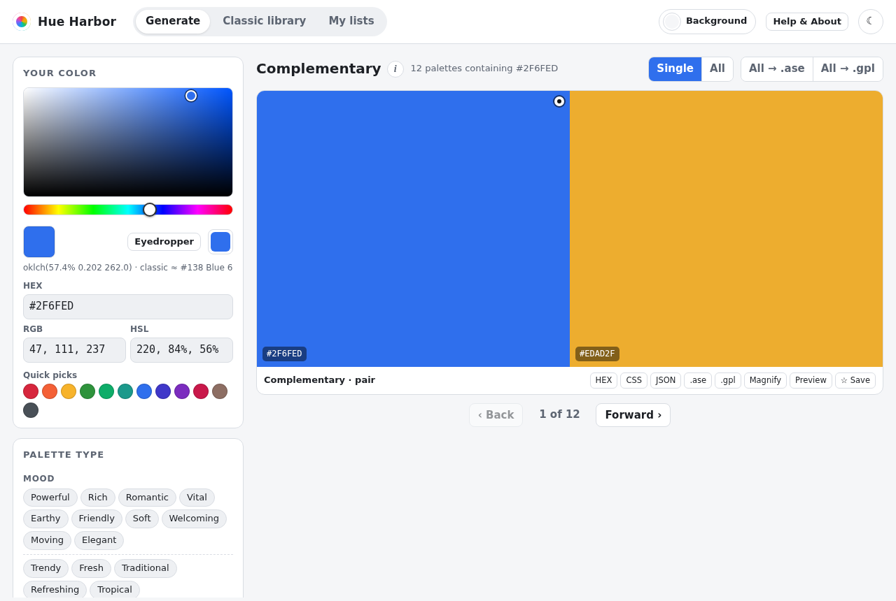

Hue Harbor is an independent, clean-room tribute to a mid-1990s Windows color-harmony program. It reuses that program's *factual color data* (152 base colors and 3,400 curated color sets) but none of its code, artwork, names or text. See [Credits and legal notes](#credits-and-legal-notes).

---

## Contents

- [Features at a glance](#features-at-a-glance)
- [Quick start](#quick-start)
- [Live demo / Publishing on GitHub Pages](#live-demo--publishing-on-github-pages)
- [Browser support](#browser-support)
- [How to use Hue Harbor](#how-to-use-hue-harbor)
  - [1. Pick a color](#1-pick-a-color)
  - [2. Choose a palette type](#2-choose-a-palette-type)
  - [3. Browse the palettes](#3-browse-the-palettes)
  - [4. Classic library](#4-classic-library)
  - [5. Swatch details and copying](#5-swatch-details-and-copying)
  - [6. Magnify](#6-magnify)
  - [7. Preview — sample designs and your photo](#7-preview--sample-designs-and-your-photo)
  - [8. My lists (favorites)](#8-my-lists-favorites)
  - [9. Export to other programs (.ase / .gpl)](#9-export-to-other-programs-ase--gpl)
  - [10. Page background, light and dark theme](#10-page-background-light-and-dark-theme)
  - [11. Keyboard shortcuts](#11-keyboard-shortcuts)
- [Privacy](#privacy)
- [FAQ and troubleshooting](#faq-and-troubleshooting)
- [For developers](#for-developers)
- [Credits and legal notes](#credits-and-legal-notes)
- [License](#license)

---

## Features at a glance

- **Start from any color** — a color square with hue bar, HEX / RGB / HSL fields, quick-pick chips, your system's color dialog, and a screen eyedropper (Chromium browsers only).
- **51 palette types** in three groups: 24 *Mood* types, 12 *Classic theory* types and 15 *Modern* types.
- **Three ways to browse** — one palette at a time (*Single*), or all of them as a grid or as rows (*All*).
- **Classic library** — browse all 3,400 recovered color sets by mood, by theory scheme or by any of the 152 base colors.
- **Swatch details** — click a color for HEX, RGB, HSL, OKLCH, an estimated CMYK and the nearest classic base color.
- **One-click copying** — copy a whole palette as HEX, CSS variables or JSON.
- **Magnify** — see a palette in six layout patterns with sample text.
- **Preview** — apply a palette to six sample designs (website, poster, interior, outfit, dashboard, products), to a **typography sample** with 36 embedded fonts, or to **your own photo** (gradient map, posterize, duotone) and download the result as a PNG. A **Precise** mode shows every palette color with its exact value.
- **My lists** — up to 30 favorites lists, exported and imported as JSON.
- **Swatch-file export** — `.ase` (Adobe Swatch Exchange) and `.gpl` (GIMP palette) for single palettes, whole lists, or everything on screen.
- **Page background control** and a **light / dark theme**.
- **Private by design** — a single HTML file, no server, no account, no tracking; photos never leave your computer.

---

## Quick start

1. Download **`palette_picker.html`** (use the *Download raw file* button on GitHub, or *Code → Download ZIP* and unzip it).
2. Double-click the file. It opens in your default web browser.
3. That's it. There is nothing to install and you do not need an internet connection. (The file is about 1.3 MB; most of that is the 36 fonts embedded for the Text preview.)

Your settings and favorites lists are stored by your browser (in its *local storage* for this file), so they are still there the next time you open it — as long as you open the file from the same location with the same browser.

> **Tip:** bookmark the file or keep it somewhere easy to find. Moving the file to a different folder makes the browser treat it as a new page, so your lists will not follow it. Export your lists as JSON first (see [My lists](#8-my-lists-favorites)) and import them again afterwards.

Prefer not to download anything? The same app runs in your browser at **<https://blohojo.github.io/HueHarbor/>** (see [Live demo / Publishing on GitHub Pages](#live-demo--publishing-on-github-pages)). It is exactly the same file; your lists are simply stored under that web address instead of under the downloaded file.

---

## Live demo / Publishing on GitHub Pages

The app is published with **GitHub Pages**, GitHub's free static hosting, at:

**<https://blohojo.github.io/HueHarbor/>**

It is the same single file as the download — nothing is installed and no data leaves your browser.

**How it works (the default, nothing to run):** the repository root contains `index.html`, a byte-for-byte copy of `palette_picker.html`, plus an empty file called `.nojekyll`. With the Pages source set to a branch, GitHub serves `index.html` as the homepage; `.nojekyll` tells GitHub to publish the files exactly as they are (without it, GitHub would turn `README.md` into the homepage instead). Both HTML files are written by the build script, and `python3 build/check_site.py` confirms they are identical.

**Setting it up on a fork or a new copy** (once, by the repository owner):

1. Open the repository on GitHub and click **Settings**.
2. In the sidebar, under *Code, planning, and automation*, click **Pages**.
3. Under **Build and deployment**, set **Source** to **Deploy from a branch**, choose **`main`** and **`/ (root)`**, and click **Save**.
4. Wait a minute or two, then open `https://<your-username>.github.io/<repo-name>/`. Every later push to `main` updates the site automatically.

**Optional: publishing with GitHub Actions instead.** The repository also contains a workflow (`.github/workflows/pages.yml`) for owners who prefer the *GitHub Actions* source. It uploads only `palette_picker.html` (as `index.html` and under its own name), the README screenshots and a `.nojekyll` marker. To use it, set **Source** to **GitHub Actions** in the same settings page, then open the **Actions** tab, choose *Deploy to GitHub Pages* and click **Run workflow**. The workflow is run by hand on purpose: while the source is *Deploy from a branch*, GitHub rejects Actions deployments, so an automatic run on every push would fail each time. If you switch to the Actions source permanently, you can make it automatic again by adding `push: branches: [main]` under `on:` in the workflow file.

---

## Browser support

Hue Harbor is tested automatically in current **Chromium** and **Firefox**; it should also work in Chrome, Edge, Brave, Opera, Vivaldi and other Chromium-based browsers.

| Feature | Chrome / Edge / other Chromium | Firefox | Notes |
|---|---|---|---|
| Everything except the eyedropper | ✅ | ✅ | |
| **Eyedropper** (pick a color anywhere on screen) | ✅ | ❌ | Uses the browser's EyeDropper API, which Firefox does not provide. The button is greyed out where it is unavailable (hover it for a note); use the system color dialog instead. |
| Copy to clipboard | ✅ | ✅ | If the modern clipboard API is blocked, Hue Harbor falls back to the browser's older copy command; if that also fails you see a “Copy failed” message. |
| Photo effects and PNG download | ✅ | ✅ | The full-size PNG is produced in a background thread, so the page stays responsive. |

Safari has not been tested.

---

## How to use Hue Harbor

A note on spelling: a few labels inside the app use British spelling (*colour*); this guide quotes them exactly as they appear.

The top bar has three modes: **Generate** (palettes built around your color), **Classic library** (the recovered 1990s sets) and **My lists** (your favorites). On the right are the **Background** button, **Help & About**, and the theme switch (◐).

### 1. Pick a color

In **Generate** mode, the *Your color* panel offers several ways to choose a color:

- Drag inside the **color square** (brightness and saturation) and along the **hue bar** below it. With the square focused, the arrow keys nudge the color; hold Shift for bigger steps.
- Type into the **HEX**, **RGB** or **HSL** fields and press Enter (or click elsewhere). Accepted examples: `#2F6FED`, `2f6fed`, `47, 111, 237`, `220, 84%, 56%`. An unreadable value is outlined in red and ignored.
- Click one of the **Quick picks** chips.
- Click the small color box next to *Eyedropper* to open your **system's color dialog**.
- Click **Eyedropper** to pick a color from anywhere on your screen (Chromium browsers only).

Under the big swatch you can see the color in OKLCH and the nearest of the 152 classic base colors.

### 2. Choose a palette type

The *Palette type* panel lists all 51 types in three groups. Click the **i** button next to the page title for a short explanation of the selected type.

**Mood** (24) — built from the recovered 1990s color sets and re-tuned so that your exact color is a member. The sets are grouped as they were in the original program:

- Powerful · Rich · Romantic · Vital · Earthy · Friendly · Soft · Welcoming · Moving · Elegant
- Trendy · Fresh · Traditional · Refreshing · Tropical
- Classic · Dependable · Calm · Regal · Magical · Nostalgic · Energetic · Subdued
- Professional

**Classic theory** (12) — computed from color-wheel rules:

- Achromatic · Analogous · Clash · Complementary · Distinct · Monochromatic · Neutral · Similar · Split Complementary
- Primary · Secondary · Tertiary

**Modern** (15) — additional schemes, several of them computed in the perceptual OKLCH color space so that steps look even to the eye:

- Triadic · Tetradic (Square) · Rectangle (Double Complementary) · Accented Analogous · Compound
- Shades · Tints · Tones
- Perceptual Analogous · Perceptual Triad · Perceptual Complement
- Pastel · Neon / Vivid · Muted / Dusty · High Contrast (WCAG)

The heading above the palettes tells you how many palettes contain your color for the selected type. A small ring-dot marks your color inside each palette.

### 3. Browse the palettes

- **Single** shows one palette at a time. Use **‹ Back** / **Forward ›**, the ← → arrow keys, or click the *“3 of 12”* counter to jump to a specific palette.
- **All** shows every palette for the current type, 24 per page. Choose **Grid** (cards) or **Rows** (one wide strip per palette). Double-click a card to open it in Single view.

Every palette card has a row of buttons: **HEX**, **CSS** and **JSON** (copy), **.ase** and **.gpl** (download), **Magnify**, **Preview** and **☆ Save** (add to the current favorites list).

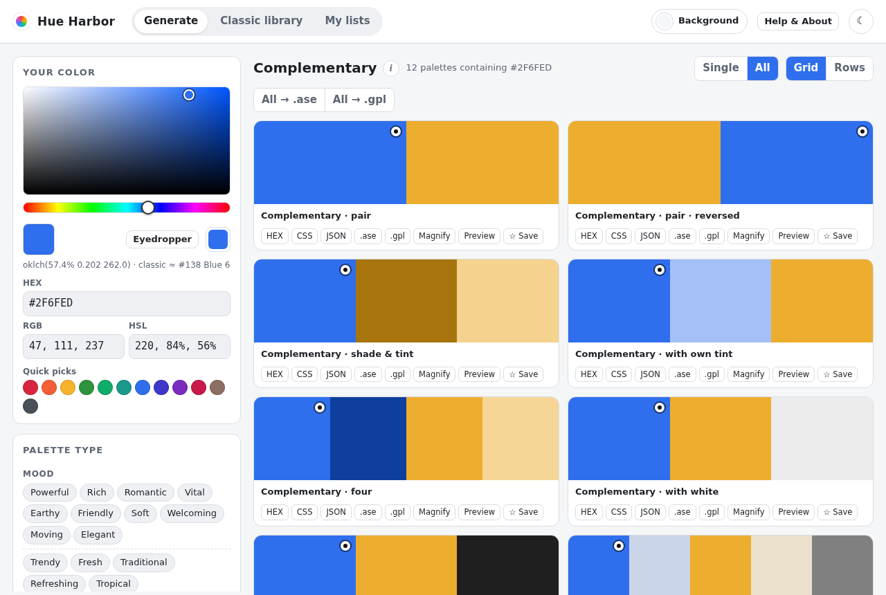

### 4. Classic library

**Classic library** mode lets you browse the complete set of 3,400 recovered color sets, 12 per page, without starting from a color of your own. Filter them by:

- **Mood** — one of the 24 moods;
- **Theory scheme** — one of the 12 classic theory schemes;
- **Color** — click one of the 152 base colors in the grid, or press **Use nearest to my color** to jump to the base color closest to the one you picked in Generate mode.

Each set's card is named *Set #n* and notes the mood and/or scheme it belonged to. Click a swatch to see its nearest base color and estimated ink number.

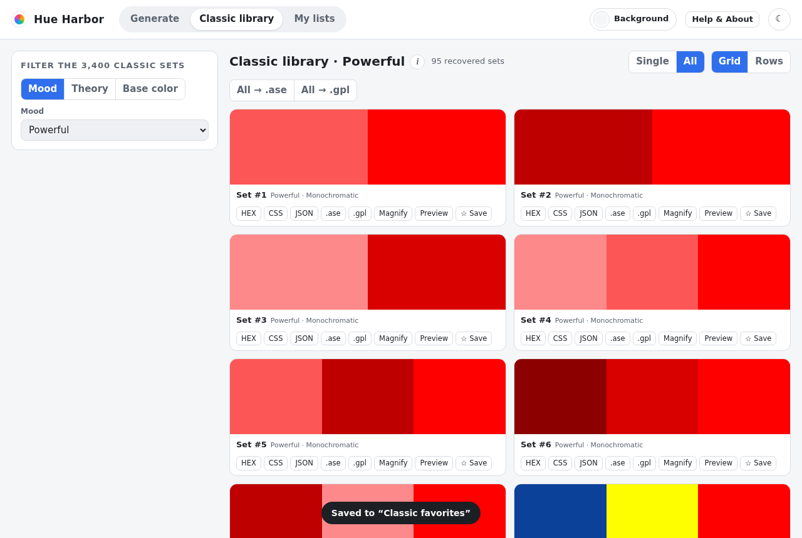

### 5. Swatch details and copying

Click any swatch in any palette to open a small details card with:

- **HEX**, **RGB**, **HSL** and **OKLCH** values, each with a copy button;
- an **estimated CMYK** value (a simple conversion, not calibrated for any printer);
- the **nearest classic base color**: its number, name and estimated ink number;
- **Use as my colour**, which makes that swatch the new starting color (and switches to Generate mode), and **Classic sets with this**, which opens the Classic library filtered by the nearest base color.

To copy a whole palette, use the **HEX**, **CSS** (custom properties) or **JSON** button on its card. A short “Copied” message confirms it.

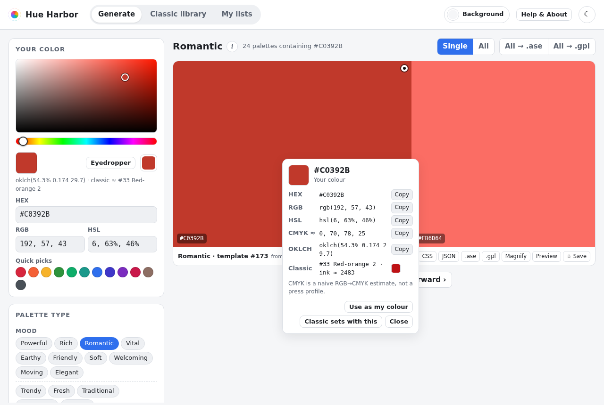

### 6. Magnify

**Magnify** opens the palette large, in one of six layout patterns — *Panels, Nested, Horizontal bars, Vertical bars, Diagonal, Vertical stripes* — with sample text on each color. *Vertical bars* is the former "Diagonal" (one equal bar per color); *Diagonal* is a true 45° stripe pattern that cycles through the palette. Click any area (or press **Rotate**) to rotate the colors around, press **Pattern** to change the layout and **Background** to cycle the backdrop behind the sample. The two sample lines sit inside the pattern area; the lower one (the view name, template and palette number) switches between white and near-black according to the colors actually beneath it, so it stays readable on every pattern and background. **‹ Prev** / **Next ›** or the ← → keys step to the previous or next palette, and **Copy HEX**, **Preview** and **☆ Save** are available from here too.

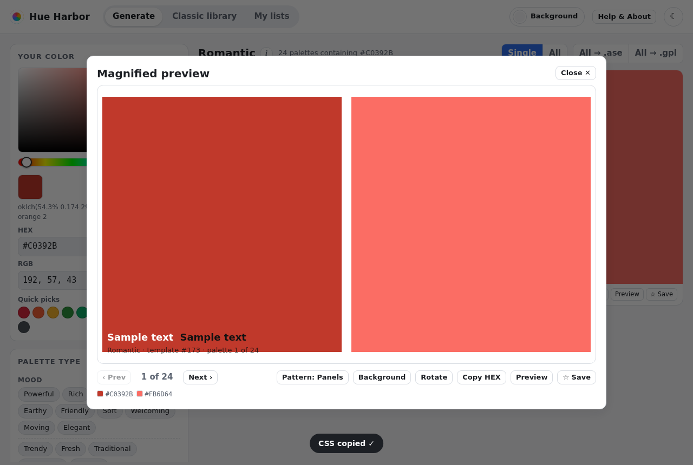
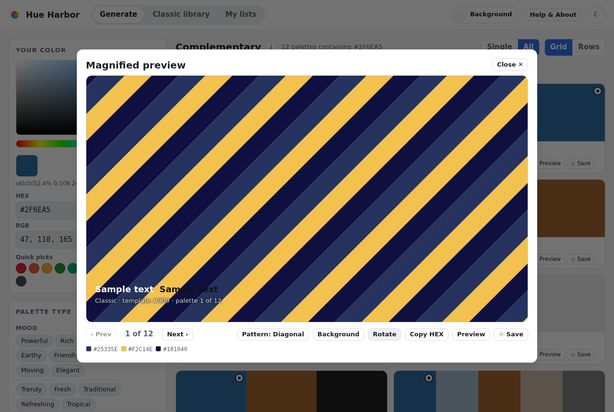

### 7. Preview — sample designs and your photo

**Preview** applies the palette to six original sample designs, a typography sample and a photo:

- **Website**, **Poster**, **Interior**, **Outfit**, **Dashboard** and **Products** tabs. Hue Harbor assigns the colors to roles (background, surface, primary, accent, text) automatically: text is chosen for WCAG contrast against its background, and missing roles are derived as lighter or darker versions of the palette colors. Use **⇄ Shuffle roles** to try a different assignment and **Light / Dark** to change the base. The role chips under the design show which color plays which role; the swatches in the dialog's header are the palette itself — click one (or focus it and press Enter) to copy that hex. **Products** is a 2 × 2 grid of flat product illustrations — over-ear headphones, an insulated tumbler, a smartwatch and a gaming controller — each split into two or three colors (cups and band, body and lid, case and strap, body and buttons) with a labelled card behind it. A **Tech / Everyday** switch, shown beside the Shuffle button only on this tab, swaps in a second set — a sneaker, a backpack, a phone case and a coffee mug — drawn and colored the same way (upper and sole, body and pocket, case and camera bump, body and handle). The chosen set stays selected while you step through palettes or change tabs.
- **Text** shows the palette on typography: a display heading, heading, subheading, body text, caption and link on the background and a surface panel. Pick one of 36 embedded fonts (sans-serif & geometric, serif & slab, monospace, script & handwritten, display) from the **Font** menu — they are built into the file, so this works offline — and press **Edit text…** to replace the sample copy with your own (**Reset text** brings the sample back). The fonts are regular-weight Latin subsets (about 780 KB of WOFF2, which grows to roughly 1.05 MB once base64-encoded into the file) under the SIL Open Font License or Apache 2.0; see [FONTS_NOTICE.md](FONTS_NOTICE.md) for each font's designer and license.
- **Precise** (checkbox under the design) makes every palette color appear with its **exact** value — nothing tinted, shaded or faded — and prints the hex on each role chip. With Precise on, a second checkbox, **Use exact number of colours**, chooses between two ways of doing that (remembered per preview type):
  - *on* — a layout designed for the palette's own color count (2, 3, 4 or 5 colors; palettes with more get the five-color layout plus a strip of the remaining colors). The Text preview adapts its levels too: 2 colors give one heading on a background of the other, 3 add a subheading, 4 add body text on a surface panel, 5 add a caption and link.
  - *off* — the standard layout, with the palette colors filling Background, Text, Primary, Accent and Surface (in that order) and only the roles the palette cannot fill derived in keeping with its type or rule (extra hues for hue-based schemes, lightness steps for monochrome ones, variations of the palette's own colors for moods and classic sets). Any palette color that still finds no place is shown in a strip along the bottom.

  **⇄ Shuffle roles** keeps working in Precise mode — it permutes the exact colors between roles — and **Light / Dark** picks the background from the dark or the light end of the palette. Precise mode does not apply to **Your photo**.
- **Your photo** recolors an image with the palette using one of three effects:
  - **Gradient map** — the palette, ordered from darkest to lightest, replaces the image's tones;
  - **Posterize** — every pixel snaps to the nearest palette color;
  - **Duotone** — shadows and highlights are mapped between two colors you choose from the palette.

  The **Intensity** slider blends between the original and the effect. A built-in sample scene is shown until you press **Load photo…** and choose a picture of your own; **Use sample** brings the sample back. **Download PNG** saves the result at the photo's full resolution (longest side up to 4096 pixels).

Inside Preview, **‹ Prev** / **Next ›** and the arrow keys move through the palettes of the current view, so you can compare several palettes on the same design.

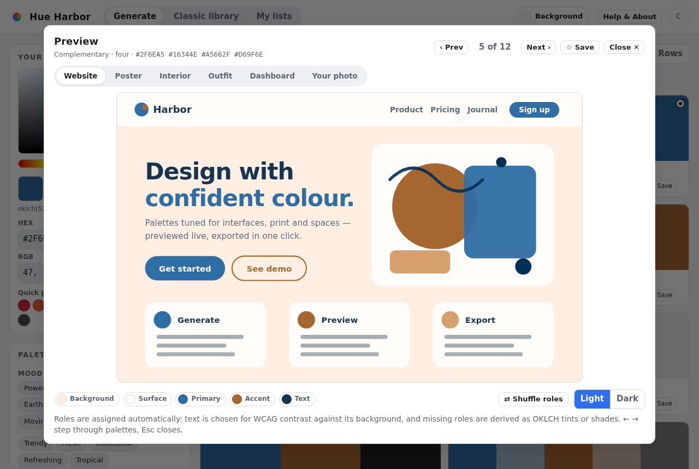
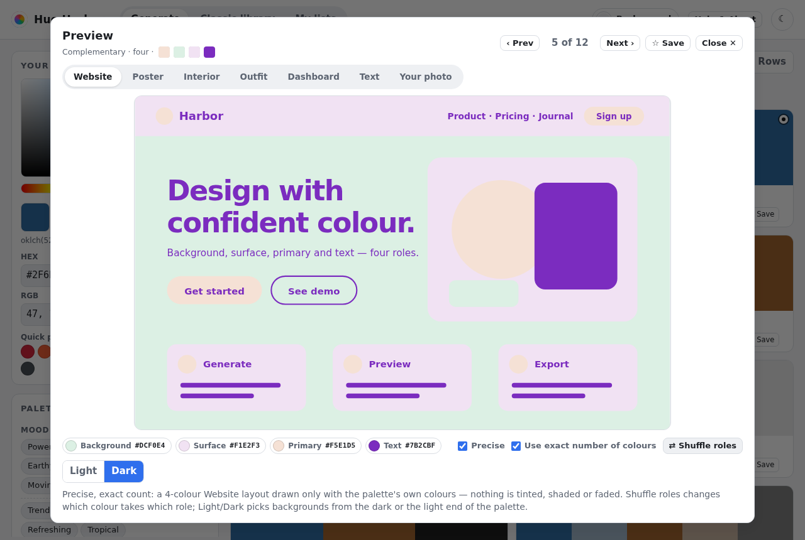
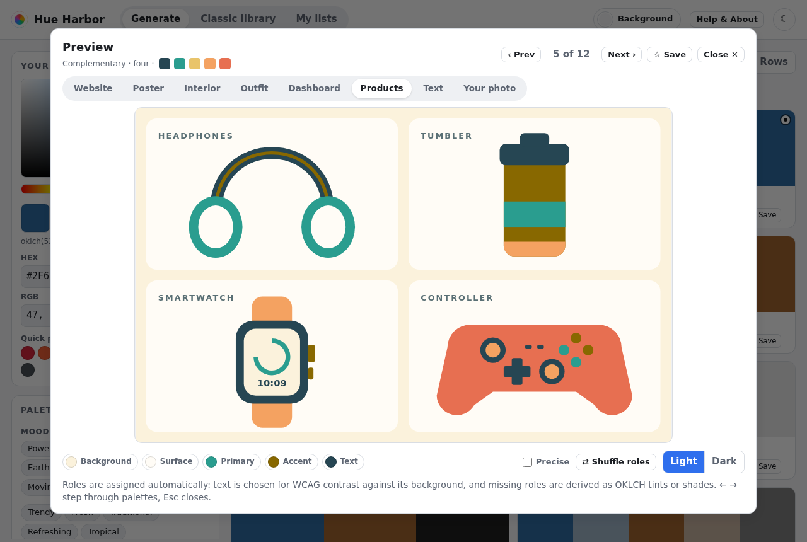
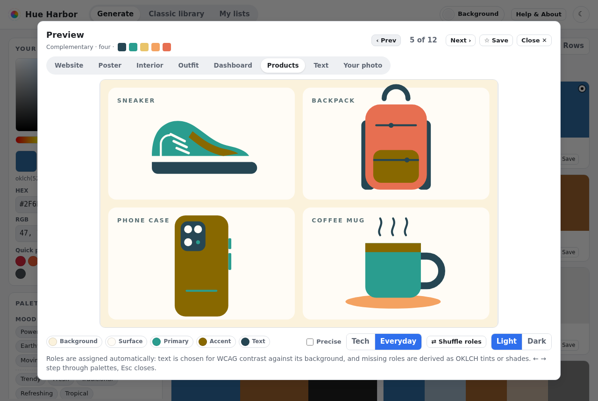
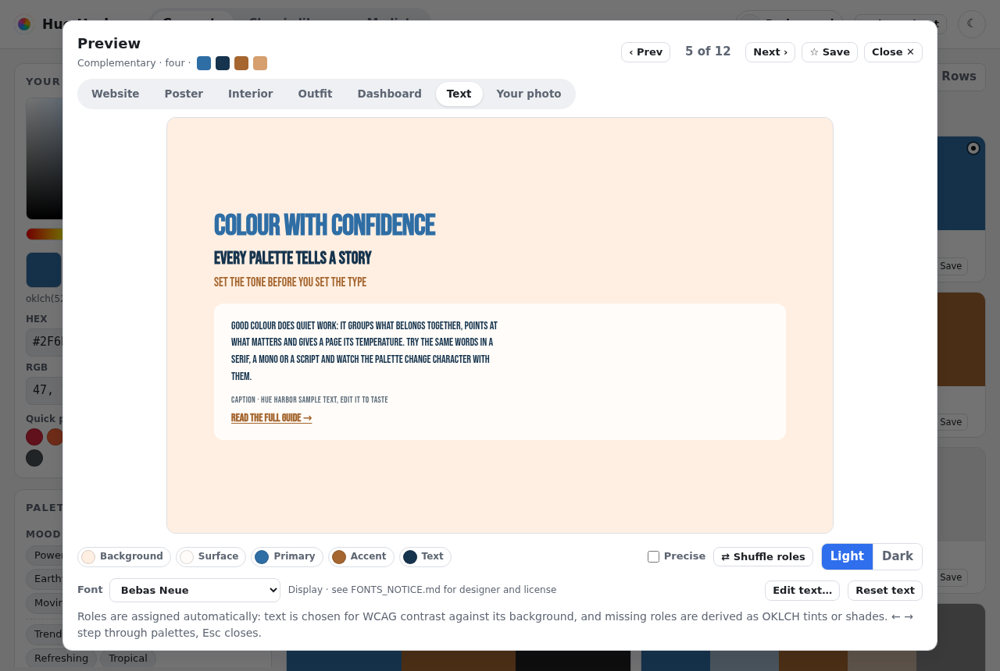
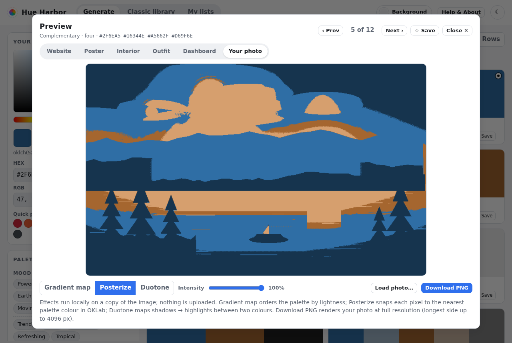

### 8. My lists (favorites)

Press **☆ Save** on any palette (card, Magnify or Preview) to add it to the current list; press it again to remove it. **My lists** mode shows the lists and lets you manage them:

- **New**, **Rename**, **Delete** — up to 30 lists. Names may use letters, digits, spaces, hyphens and underscores (up to 30 characters). You always keep at least one list. A starter list called *Classic favorites* is provided.
- **Export JSON** / **Import JSON** — save a list as a small text file, or load one you exported earlier (for example in another browser or on another computer). Imported lists are added as new lists; nothing is overwritten.
- **Export .ase** / **Export .gpl** — write the whole list as one swatch file (see the next section).

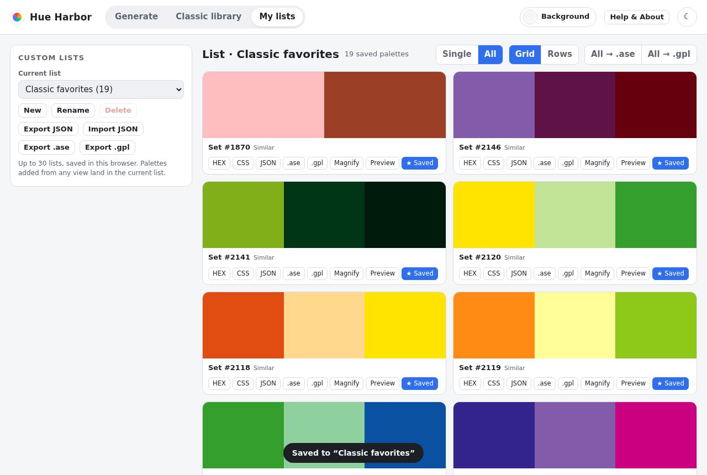

### 9. Export to other programs (.ase / .gpl)

Hue Harbor writes two standard swatch formats:

- **`.ase`** — Adobe Swatch Exchange, for Adobe Photoshop, Illustrator, InDesign and many other programs. Each palette becomes a named group of RGB swatches.
- **`.gpl`** — GIMP palette, a plain-text format read by GIMP, Inkscape, Krita, MyPaint and others.

You can export at three levels:

| Where | Button | What you get |
|---|---|---|
| A palette card | **.ase** / **.gpl** | That one palette |
| Toolbar above the palettes | **All → .ase** / **All → .gpl** | Everything in the current view: all palettes for the selected type and color, every set matching the current library filter, or the current list |
| My lists panel | **Export .ase** / **Export .gpl** | Every palette in the current list |

**Importing the file**

- **Photoshop** — open the *Swatches* panel, open its menu (≡) and choose **Import Swatches…**, then select the `.ase` file.
- **Illustrator** — in the *Swatches* panel menu choose **Open Swatch Library → Other Library…** and select the `.ase` file.
- **GIMP** — copy the `.gpl` file into your GIMP `palettes` folder (*Edit → Preferences → Folders → Palettes* shows where it is), then choose **Refresh** in the *Palettes* dialog. Alternatively, drag the file onto the Palettes dialog.
- **Inkscape** — copy the `.gpl` file into the `palettes` folder of your Inkscape user configuration (*Edit → Preferences → System → User palettes* shows the path) and restart Inkscape. The palette then appears in the palette menu at the bottom of the window.
- **Krita** — in the *Palette* docker, choose **Import a new palette** and select the `.gpl` file.

Menu names vary slightly between versions; if in doubt, search your program's help for “import swatches” or “palette”.

### 10. Page background, light and dark theme

- The **Background** button in the top bar changes the color of the page behind the palettes — handy for judging a palette against the color it will actually sit on. Choose one of the quick picks (**#FFFFFF, #D4D0C8, #BFBFBF, #808080, #000000**), use the color dial, or type a hex code. The page text re-tints itself so it stays readable; the cards keep their own surface color. **Reset** returns to the theme default.
- The **◐** button switches between the **light** and **dark** theme. On first use Hue Harbor follows your system's preference.

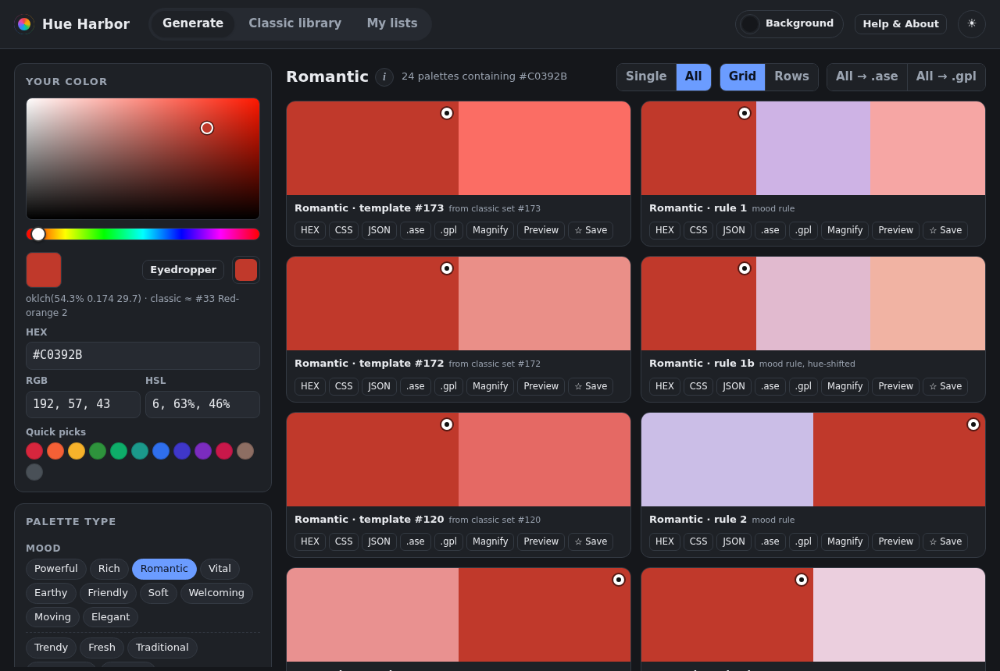

### 11. Keyboard shortcuts

| Keys | What they do |
|---|---|
| ← / → | Previous / next palette (in Single view, Magnify and Preview) |
| Esc | Close the open pop-up or window |
| Arrow keys in the color square | Nudge saturation / brightness (Shift = larger steps) |
| Enter in a HEX / RGB / HSL field | Apply the typed color |

---

## Privacy

Hue Harbor is one HTML file that runs entirely inside your browser.

- It makes **no network requests**: no server, no analytics, no fonts or scripts loaded from the internet.
- Your settings and favorites lists are kept in your browser's local storage on your own computer.
- Photos you load into Preview are processed in memory in your browser and are **never uploaded anywhere**. They are not saved either — reload the page and the photo is gone.

---

## FAQ and troubleshooting

**The Eyedropper button is missing.**
Your browser does not offer the EyeDropper feature (Firefox and Safari do not). Use the small color box next to it to open the system color dialog, or type a value.

**My lists disappeared.**
Lists live in your browser's local storage *for the location of the file*. They will not be visible if you open the file from a different folder or drive, in a different browser, in a private/incognito window, or after clearing site data. Use **Export JSON** regularly as a backup, and **Import JSON** to bring lists back.

**“Could not save lists (storage full?)”**
Your browser's storage for this page is full or blocked. Export some lists, delete what you no longer need, or check that your browser allows the site to store data.

**Copying does nothing, or says “Copy failed”.**
Some browsers restrict clipboard access for files opened from disk. Hue Harbor tries two different copy methods; if both are blocked, open the swatch details card and read the values from there, or export the palette as a file instead.

**The CMYK values do not match my print shop's.**
They are simple estimates from RGB and are not color-managed. Use them as a rough guide only.

**The photo effect looks blocky or slow.**
Previews are rendered at screen size and should update instantly. The full-size PNG download of a very large photo can take a second or two; the longest side is capped at 4096 pixels.

**Can I use it on a phone or tablet?**
Yes — the layout adapts to narrow screens — but it is designed first for a desktop browser.

---

## For developers

Everything the user needs is `palette_picker.html`; the rest of the repository is the source it is built from.

```
palette_picker.html   the app: a single self-contained file (generated — do not edit by hand)
index.html            identical copy served by GitHub Pages (generated — do not edit by hand)
.nojekyll             empty marker: tells GitHub Pages to serve the files as they are
build/
  head.html           <head>, CSS
  body.html           page markup
  data.js             recovered color data (152 base colors, 3,400 sets, mood/scheme membership)
  app1.js             color math (RGB/HSL/OKLCH/CMYK) and palette generation
  app2.js             state, persistence, UI, library, lists, exports, background/theme
  app3.js             Preview: SVG scenes, Precise/exact-count layouts, Text preview, photo effects, PNG export worker
  fonts/              36 WOFF2 Latin subsets for the Text preview + manifest.json (embedded as base64 by assemble.py)
  assemble.py         concatenates the parts above into palette_picker.html and index.html
  check_site.py       checks index.html == palette_picker.html and that .nojekyll exists
  browsers.py         shared Playwright browser selection for the tests
  test.py             main functional tests
  test_export.py      .ase / .gpl file-format checks
  test_bg.py          page-background control
  test_ff_probe.py    Firefox/Chromium behavior probes (pointer, keyboard, CSS, layout)
  test_preview.py     Preview scenes, Precise mode, Text preview and fonts, swatch copy, photo effects, PNG download
  test_magnify.py     Magnify patterns (Vertical bars vs Diagonal geometry), overlay text placement and contrast
  test_perf.py        photo-pipeline benchmark with a 4000×3000 image
  test_ffdev.py       optional: Preview smoke run in a stock Firefox Developer Edition via geckodriver + Selenium (see its docstring)
data/                 the recovered color data as CSV/JSON (source of data.js)
docs/                 screenshots used in this README and review logs (docs/qc_review_log.md)
FONTS_NOTICE.md       the embedded fonts: designer, license and the OFL / Apache license texts
```

**Build** (Python 3, no dependencies):

```bash
python3 build/assemble.py        # writes palette_picker.html
```

**Tests** use [Playwright for Python](https://playwright.dev/python/) with Chromium and Firefox. Install once:

```bash
pip install playwright pillow numpy
playwright install chromium firefox
```

Run a suite in Chromium (default) or Firefox:

```bash
python3 build/test.py
BROWSER=firefox python3 build/test.py
```

If your Playwright browsers are installed in a custom location, point Playwright at it, for example:

```bash
export PLAYWRIGHT_BROWSERS_PATH=/home/ubuntu/.pw-browsers
```

Suites: `test.py`, `test_export.py`, `test_bg.py`, `test_ff_probe.py`, `test_preview.py`, `test_magnify.py`, `test_perf.py`. Each prints `ERRORS []` (and `FAILS []` where applicable) and exits with status 0 when it passes. Screenshots and exported files are written to `shots/` (ignored by git); generated test images go to `~/.tmp/hueharbor-fixtures/` (override with `HH_FIXTURES=/some/dir`).

The modals (Help, Magnify, Preview) keep keyboard focus inside while open and return it to the button that opened them; the app also honours the operating system's *reduce motion* setting.

---

## Credits and legal notes

- Hue Harbor is an **independent, clean-room project**. It was written from scratch, inspired by a mid-1990s Windows color-harmony program. No source code, artwork, logos, program text or product names from that program are used, and no affiliation with or endorsement by its publishers is implied.
- The **numeric color data** — 152 base colors and 3,400 curated color sets, with their mood and scheme memberships — was recovered from the abandoned original. Hue Harbor treats these as facts (lists of color values); the way they are presented, searched and combined here is new work.
- “Ink numbers” are estimates of the nearest reference in a commercial printing-ink system, included only to help identify colors; the names of color systems and programs mentioned in this document belong to their respective owners.
- CMYK values are naive conversions and are not color-managed.
- The 36 fonts embedded for the Text preview are open-source typefaces under the SIL Open Font License 1.1 (Roboto Slab: Apache License 2.0); they keep their own licenses, which are reproduced in [FONTS_NOTICE.md](FONTS_NOTICE.md).

---

## License

The code, design and documentation are released under the
[MIT License](LICENSE) — © 2024–2026 Jacob Holmes.

The palette data (the 152 foundation colors, ~3,400 color sets and
scheme/mood groupings) originates from Palette Picker by Lightdream Design,
adapted from Rockport Publishers' *Color Harmony* books.  It is included for
preservation purposes; see [DATA_NOTICE.md](DATA_NOTICE.md) for details.
