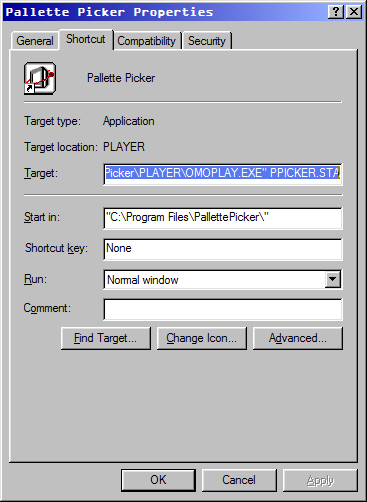

## Palette Picker

This is the original application. It is included here because it is [not archived](https://web.archive.org/web/20260000000000*/ftp://ftp.lightdream.com/pub/downloads/PPicker.zip) on the [Wayback Machine](https://archive.org/).

The program's run command (as an example) is:
-  `"C:\Program Files\PallettePicker\PLAYER\OMOPLAY.EXE" PPICKER.STA`
 
 
You create a shortcut for `OMOPLAY.EXE` then add the `PPICKER.STA` as a command line argument, then enter the location of `PPICKER.STA` for `Start in:` (i.e., `"C:\Program Files\PallettePicker\"` in the above example):

 
 
Note that this **does not run** on Windows 10, regardless of any Compatibility options that you set. You will always get this error:

 

 
 
It should run OK on Windows XP (via VM). Windows Vista, 7, and 8 have **not** been tested.
